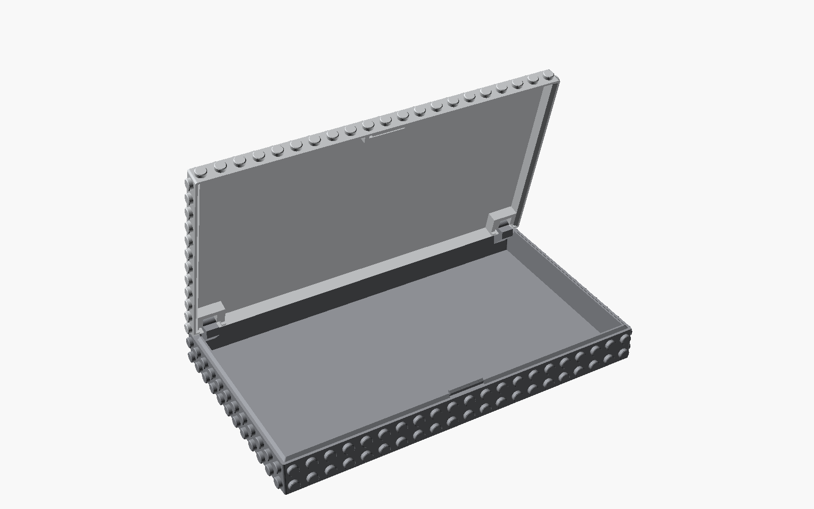
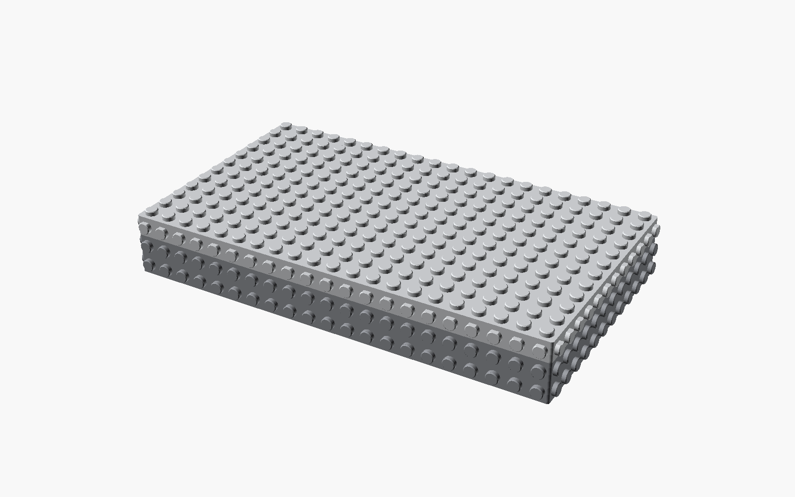
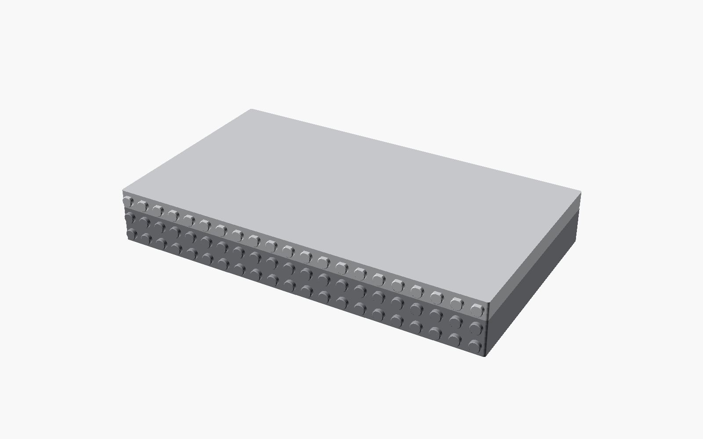
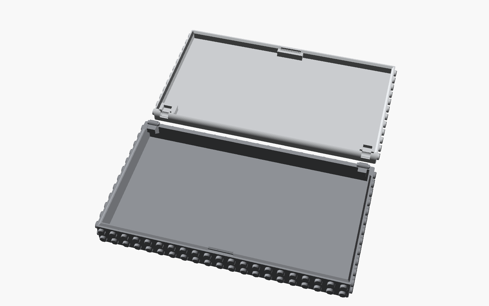
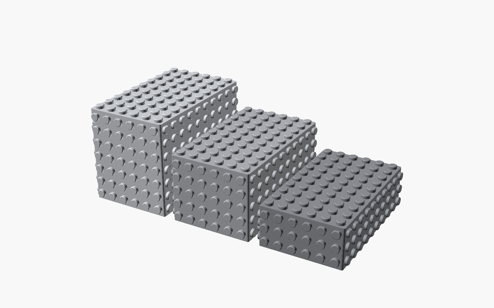

# Parametric brick boxes

Printable, parametric storage boxes, LEGO-compatible and written in OpenSCAD:
studded edge to edge on every side and on the lid (each face can be studs, sockets
or flat), with storage inside.

| Closed | Studs only front and back |
|---|---|
|  |  |
| **Print layout** | **Rows 0, 1 and 2** |
|  |  |

- Everything is in LEGO units: footprints in studs (8 mm), heights in stud rows (8 mm).
- Box size is set directly in studs (`studs_l` x `studs_w`).
- Every box is whole stud rows tall, with studs round the lid band too, so the side
  studs of neighbouring boxes line up. `side_rows` sets the height and `lid_rows` how
  many of those rows are lid. A lid taller than one row swings out behind the box by
  8 mm per extra row when it's open.
- Every face (`top`, `bottom`, `front`, `back`, `left`, `right`) is set to `studs`,
  `sockets` or `flat` in the Customizer's **Studs** group. Sockets are holes that take
  studs, so a box presses onto a baseplate or onto another box's studs. Flat faces take
  a label, or stand flush against a wall or another box.
- Optional text label on the lid top (**Lid label** group): set `label`, and it's
  centred on the lid with the top studs or sockets round it left out. The text is engraved into the top skin (prints without supports) or raised off it
  (`label_style`), in any installed font (`label_font`).
- Set `row` for where the box will stand (0 = front): each row back is taller, so
  whatever stands on the boxes in back sits higher.
- Hinged lid on two pinned tabs at the back: friction holds it at any angle up to 90°,
  and it lifts off at 90°.
- Hollow lid: a thin top skin (`lid_top`, thickened automatically under top sockets) over
  an open underside, inside the outer lip, with solid blocks only round the hinge slots
  and the detent.
- Snaps shut on a detent: a bead on the front wall top clicks into the lid; squeeze the
  middle of the box front to release it (`detent_count`, `detent_len`; `detent_bump` sets
  how firm the snap is).
- The body prints upright and the lid inverted (top down). A part standing on studs
  (bottom studs for the body, top studs for the lid) needs supports. With `sockets` or
  `flat` there, it prints flat without supports. Print `stud_fit_test.scad` first to
  find your stud and socket sizes, then a small 6 x 5 box to check the whole fit.
  For reference, on the author's Bambu Lab A1 printing SUNLU PLA 2.0+,
  `stud_d = 5.05` (top) and `side_stud_d = 5.00` (sides) clutch well.

## Use

Open `parametric_brick_boxes.scad` in OpenSCAD (a recent nightly with the
Manifold backend renders much faster) and use the Customizer. Set the size and `row`,
pick `part = print / body / lid / assembled`, then render and export.

`archive/` holds an earlier, decorative pillar version.

## License

© 2026 Aaron Breckenridge. Licensed under
[Creative Commons Attribution-ShareAlike 4.0 International](https://creativecommons.org/licenses/by-sa/4.0/)
(CC BY-SA 4.0); see [LICENSE](LICENSE).

LEGO® is a trademark of the LEGO Group, which does not sponsor, authorize or endorse
this project.
